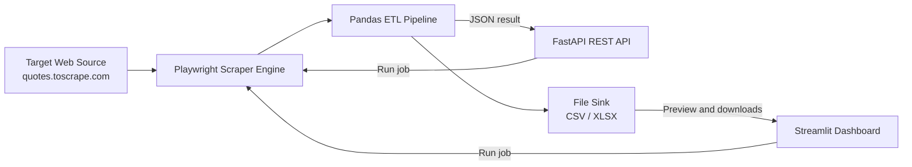

# ⚡ Enterprise ETL & Automated Scraping Suite

[](https://github.com/mkayara/enterprise-etl-scraper/actions/workflows/ci.yml)


A modular web data collection and processing application. Playwright extracts
structured quote data, a Pandas pipeline normalizes and exports the results,
and users can run jobs through a FastAPI endpoint or the Streamlit dashboard.

## System Architecture



The API and dashboard each provide an entry point to trigger the shared
scraper and pipeline. Both produce the same CSV and Excel exports.

## Key Features

- **Asynchronous browser extraction** with Playwright and Chromium.
- **Automated data cleaning** including duplicate removal and normalized
  column names.
- **Multi-format exports** to CSV and Excel using OpenPyXL.
- **Interactive management dashboard** with extraction controls, data preview,
  summary metrics, and download buttons.
- **REST API** for programmatic ETL job execution.
- **Containerized deployment** with Docker and Docker Compose.
- **CI validation** for Python syntax and scraper execution on GitHub Actions.

## Tech Stack

| Area | Technologies |
| --- | --- |
| Language | Python 3.10+ |
| API | FastAPI, Uvicorn |
| Browser automation | Playwright, Chromium |
| Data processing | Pandas, OpenPyXL |
| Dashboard | Streamlit |
| Deployment | Docker, Docker Compose |
| CI | GitHub Actions |

## Quickstart Guide

### Local setup

Create and activate a virtual environment from the repository root:

```powershell
python -m venv .venv
.\.venv\Scripts\Activate.ps1
python -m pip install -r requirements.txt
python -m playwright install chromium
```

Run the API and dashboard in separate terminals:

```powershell
uvicorn app.main:app --reload
```

```powershell
streamlit run app/ui/dashboard.py
```

The API documentation is available at `http://127.0.0.1:8000/docs`, and the
dashboard is available at `http://localhost:8501`. Use the dashboard or API to
start an extraction; exports are written to `data/latest_scrape.csv` and
`data/latest_scrape.xlsx`.

### Docker Compose

Build and start both services:

```bash
docker-compose up --build
```

Open the dashboard at `http://localhost:8501` and the API at
`http://localhost:8000`. Compose shares a named data volume between the
services so generated exports persist and are visible to both containers.

## API Reference

### `POST /api/v1/run-etl`

Runs the scraper, cleans the extracted records, and saves CSV and Excel files.

| Parameter | Type | Default | Constraints |
| --- | --- | --- | --- |
| `limit` | integer query parameter | `5` | `1`–`50` |

Example request:

```bash
curl -X POST "http://127.0.0.1:8000/api/v1/run-etl?limit=5"
```

Example response:

```json
{
  "status": "success",
  "message": "Successfully extracted and processed 5 records.",
  "exports": {
    "csv_path": "data/latest_scrape.csv",
    "excel_path": "data/latest_scrape.xlsx",
    "row_count": 5
  }
}
```

## License

This project is released under the MIT License.
